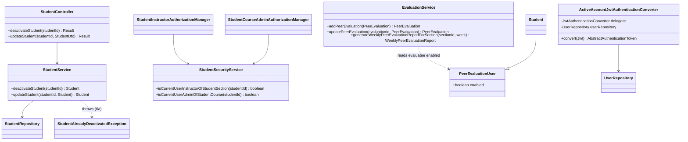
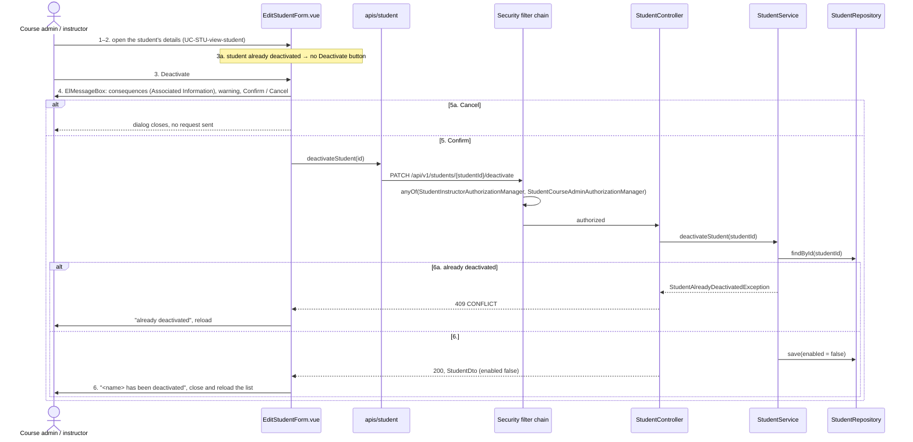
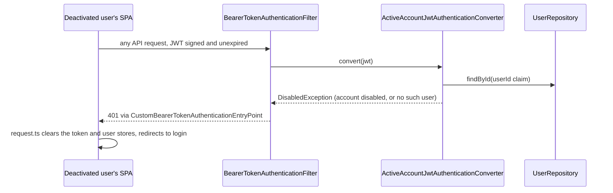

# Student (STU) Design

> Realizes: UC-STU-deactivate-student, and the deactivation clauses it added to UC-EVA-submit-evaluation (step 2, extension 9a) and UC-EVA-section-evaluation-report (students included)
> Depends on: FR-SEC-active-account, FR-SEC-authorization, BR-student-lifecycle, BR-section-scoped-access, BR-role-based-access, BR-submission-owed
> See: [use cases](../requirements/use-cases.md#student), [SRS security requirements](../requirements/software-requirements-specification.md#security-and-authorization-requirements), [architectural-design.md](architectural-design.md#shared-foundation-components) (shared-foundation component view; [Authentication](architectural-design.md#authentication) and [Authorization](architectural-design.md#authorization) under Crosscutting Concepts)
> Designed against `main` at `59f0267` (2026-11-06).

## Overview

The `student` package is part of the shared foundation: it holds the course participants who submit weekly activity reports and peer evaluations, and the account lifecycle the course admin and instructors run over them. The other STU use cases (invite, find, view, delete) were built before this workflow and are not yet designed here; this doc starts with deactivation and grows as they are.

Before this design, deactivation existed only as the `enabled` switch on the generic Edit student form (`PUT /students/{studentId}` → `StudentService.updateStudent`). That path had no consequences warning or confirmation (steps 4–5). It admitted any `ROLE_instructor` who could reach the student, through `UserOwnershipAuthorizationManager`, and shut out a course admin who was not assigned to the course section, contrary to BR-student-lifecycle. And since the JWT is stateless, a deactivated student who was already logged in kept working for the rest of her 2-hour token, contrary to FR-SEC-active-account, which the code honored only at login.

## Components & classes

| Component | Status | File |
|---|---|---|
| `StudentController.deactivateStudent` | new method | [`student/StudentController.java`](../../backend/src/main/java/team/projectpulse/student/StudentController.java) |
| `StudentService.deactivateStudent`; `updateStudent` stops applying `enabled` true → false | new method, change | [`student/StudentService.java`](../../backend/src/main/java/team/projectpulse/student/StudentService.java) |
| `StudentSecurityService.isCurrentUserAdminOfStudentCourse` (fails closed, like its siblings) | new method | [`student/StudentSecurityService.java`](../../backend/src/main/java/team/projectpulse/student/StudentSecurityService.java) |
| `StudentInstructorAuthorizationManager` | reused | [`security/authorizationmanagers/`](../../backend/src/main/java/team/projectpulse/security/authorizationmanagers/StudentInstructorAuthorizationManager.java) |
| `StudentCourseAdminAuthorizationManager`, the same shape as `StudentInstructorAuthorizationManager` | new | `security/authorizationmanagers/` |
| `ActiveAccountJwtAuthenticationConverter`, wrapping the existing `jwtAuthenticationConverter` bean | new | `security/` |
| Route rule and converter wiring | change | [`security/SecurityConfiguration.java`](../../backend/src/main/java/team/projectpulse/security/SecurityConfiguration.java) |
| `StudentAlreadyDeactivatedException`, mapped to `409` in `ExceptionHandlerAdvice` | new | `system/exception/` |
| `deactivateStudent(id)` | new | [`frontend/src/apis/student/index.ts`](../../frontend/src/apis/student/index.ts) |
| Deactivate button and confirmation; the Status switch can only turn a student on | change | [`frontend/src/pages/students/EditStudentForm.vue`](../../frontend/src/pages/students/EditStudentForm.vue) |
| `EvaluationService.addPeerEvaluation` and `updatePeerEvaluation` refuse a deactivated evaluatee (`PeerEvaluationIllegalArgumentException` → `400`) | change | [`evaluation/EvaluationService.java`](../../backend/src/main/java/team/projectpulse/evaluation/EvaluationService.java) |
| `EvaluationService.generateWeeklyPeerEvaluationReportForSection` keeps a deactivated student only for a week she was rated | change | same file |
| Peer-evaluation form lists only active teammates, in edit mode too (a stored rating of a teammate deactivated since is left off, since its edit would be refused), and submits with `Promise.allSettled` so one refused rating (9a) does not hide the saved ones. When any rating is refused, the form reloads from the server to show what was stored, warns that some were not saved, and sends no submission confirmation email | change | [`frontend/src/pages/evaluations/SubmitTeamsEvaluations.vue`](../../frontend/src/pages/evaluations/SubmitTeamsEvaluations.vue) |

## Sequence

### UC-STU-deactivate-student: deactivating a student

### FR-SEC-active-account: a deactivated account's live token

## API contract

| Endpoint or job | Caller (who may) | Request | Success | Errors, by extension |
|---|---|---|---|---|
| `PATCH /api/v1/students/{studentId}/deactivate` | An instructor assigned to the student's course section, or the course admin of the student's course (BR-student-lifecycle). Not the student herself, not another student. | path `studentId`; no body | `200`, `Result` carrying the `StudentDto` with `enabled: false` | 6a: already deactivated → `409` `CONFLICT`, account unchanged. 6b: a caller outside that scope, or an id naming no student → `403` (guards fail closed). 3a and 5a send no request. |
| `POST /api/v1/evaluations` and `PUT /api/v1/evaluations/{evaluationId}` (changed) | unchanged | unchanged | unchanged | UC-EVA-submit-evaluation 9a: the evaluatee is deactivated → `400` `INVALID_ARGUMENT`, "<firstName> has been deactivated and is no longer evaluated." Nothing stored for her; the other teammates' requests are independent and still save. |
| `GET /api/v1/evaluations/sections/{sectionId}/week/{week}` report (changed) | unchanged | unchanged | a deactivated student is in the report only if she has at least one evaluation for that week | unchanged |
| `PUT /api/v1/students/{studentId}` (changed) | unchanged | unchanged | `200` with the student's real state. `enabled` is applied only from false to true, and only for a caller with `ROLE_instructor` (as today); every other combination keeps the stored value. `StudentDto.enabled` is a primitive, so a body that omits it reads as `false`, which is exactly why false is never applied. | unchanged |
| Every API request carrying a bearer token (changed), including `permitAll()` routes | — | Bearer JWT | unchanged for an active account | the token's user is deactivated or no longer exists, or the `userId` claim is missing or not a number → `401` |

**What the SPA shows.** The Deactivate button sits in the `EditStudentForm.vue` footer, left of Cancel and Confirm, rendered only while the loaded student is enabled (3a). It opens a warning-type `ElMessageBox.confirm` titled "Deactivate student", whose body lists the consequences from the use case's Associated Information (cannot log in or submit; work and team membership kept; an open session ends; teammates stop evaluating her; can be reactivated; not a deletion), with the buttons "Deactivate" and "Cancel". On success: `ElMessage.success("<firstName> <lastName> has been deactivated.")`, then the dialog closes and the list reloads. On `409` the shared Axios instance's toast shows the server message ("This student is already deactivated."); the form adds no second message, closes, and the list reloads. The Status switch is disabled while the student is enabled, so it can only turn a student on. The list keeps its existing Enabled/Disabled tag. A deactivated user who is logged out by the `401` sees the login page; a later login attempt shows the existing account-status failure.

## Key decisions

- **Deactivation gets its own endpoint, not a field on the generic update.** Rejected: keeping it as the `enabled` field of `PUT /students/{studentId}`. The generic edit cannot require steps 4–5, it mixes a profile edit with a lifecycle change, and its route guard admits the student herself and leaves the role check to the service. A verb-shaped `PATCH .../deactivate` also leaves room for `.../reactivate` alongside it.
- **Who may: `AuthorizationManagers.anyOf(StudentInstructorAuthorizationManager, StudentCourseAdminAuthorizationManager)`**, the same pairing UC-NOT-remind-non-submitters uses for its course section routes. Rejected: `UserOwnershipAuthorizationManager`, which admits the student herself and shuts out a course admin who is not assigned to the course section; and `hasAuthority("ROLE_instructor")`, which ignores BR-section-scoped-access. The route is flat, with no container id, so the guard's lookup of the student's own course section and course is the scope; there is no second, caller-chosen id for a scoped query to check. Both checks compare ids, never roles: the instructor check is the caller's id against the instructors assigned to the student's course section (any of her course sections, not her default one), and `isCurrentUserAdminOfStudentCourse` is the caller's id against student → course section → course → course admin. So an admin of another course, who holds `ROLE_instructor` through the role hierarchy, is denied. The rule is an explicit `HttpMethod.PATCH` matcher with the other `/students/**` rules, above the API `.denyAll()`; no existing student rule matches the `/deactivate` path, so its position among them does not matter.
- **A deactivated account is refused on every request, in the JWT authentication converter.** `ActiveAccountJwtAuthenticationConverter` loads the user named by the `userId` claim and throws `DisabledException` when it is disabled or gone; the bearer-token filter turns that into the existing `401`, and the SPA's existing `401` handling logs the user out. Rejected: accepting the up-to-2-hour window, which leaves FR-SEC-active-account half-met; and a token blocklist or token-version claim, which adds a store and a migration to reach the same result. Cost: one primary-key read per authenticated request. Because it reads `PeerEvaluationUser`, it covers deactivated instructors too (UC-INS-deactivate-instructor). It is a converter rather than an `OAuth2TokenValidator` so that a disabled account takes the same `AuthenticationException` path to the same `401` as a bad token. It calls the delegate first and returns the delegate's `JwtAuthenticationToken` unchanged, so the principal stays the `Jwt` that `UserUtils` reads. Like the guards, it never throws anything but an `AuthenticationException`: a missing or non-numeric `userId` claim, or no matching user, is a `DisabledException`. It runs wherever a bearer token is presented, `permitAll()` routes included; a request with no token is untouched.
- **Already deactivated is a `409`, not a silent `200`.** Rejected: an idempotent success, because extension 6a requires telling the user. The SPA hides the button for a deactivated student (3a), so `409` arises only from a stale view: the student was deactivated after the dialog opened. Two confirms in the same instant can both read `enabled = true` and both succeed; that is accepted, because the end state is the same and nothing else is written.
- **The generic edit can still reactivate, but no longer deactivates.** `updateStudent` applies `enabled` only from false to true. Rejected: removing the toggle, which would leave no way to reactivate anyone until UC-STU-reactivate-student is built; and leaving it, which bypasses steps 4–5. OI-65 removes the remaining half with that use case. Until then the generic route still lets any instructor of the student's course section reactivate her and still shuts out an unassigned course admin; that is reactivation's gap, carried by OI-65, not this use case's.
- **The student stays on her team.** Rejected: unassigning her, because reactivation would then not restore her, and her team's weekly activity reports and peer evaluations would lose their member. Reports that list who owes something already skip her (`SubmissionStatusService`, BR-submission-owed).
- **Teammates are neither asked for nor allowed a rating of her: the form hides her, and the service refuses one.** `SubmitTeamsEvaluations.vue` drops students whose `enabled` is false, and `EvaluationService.addPeerEvaluation` / `updatePeerEvaluation` refuse a deactivated evaluatee next to the existing same-team check (BR-student-lifecycle: "no peer evaluation of her is requested or accepted"). Rejected: the form filter alone, which a direct API call bypasses and which can be deleted without any server test failing (the same lesson as the two enforcement points in the architecture-of-record); and filtering `GET /students/teams/{teamId}`, which other screens may need complete. Cost: a teammate who had not yet rated her for the week before she withdrew cannot do so afterwards, the same loss BR-evaluation-submission-window already accepts for any missed evaluation. Evaluations are stored one row per evaluatee and the server checks no completeness across the team, so refusing her rating neither fails the others nor deletes an evaluation of her already stored. The check reads her status now, even for the previous week, matching BR-submission-owed's "whose account is active". The form moves from `Promise.all` to `Promise.allSettled` so that, in 9a, the saved ratings still show and only hers reports the error.
- **The section report keeps a deactivated student only for weeks she was rated.** `generateWeeklyPeerEvaluationReportForSection` filters on `enabled || has an evaluation that week`. Rejected: keeping every student on a team, which shows her with empty rows for every week after she withdrew; hiding her entirely, which erases weeks that are part of her team's record; and a stored deactivation date, which needs a migration to answer a question the evaluations already answer, since nobody can rate her after deactivation.

## Data model

No delta: deactivation reuses `PeerEvaluationUser.enabled` (see the SRS's [Business Domain Model](../requirements/software-requirements-specification.md#business-domain-model)). No migration.

## Reuse & cross-cutting

- **Authentication:** login denial for a disabled account is already built (`MyUserPrincipal.isEnabled` → `AccountStatusException` → `401`); the converter adds the same denial for a live token.
- **Authorization:** reuses `StudentInstructorAuthorizationManager`, `PathVariables.readId`, and the fail-closed `*SecurityService` convention.
- **Errors and envelope:** `Result`, `ExceptionHandlerAdvice`, `StatusCode.CONFLICT`.
- **SPA:** the shared Axios instance's `401` handling does the logout; no new client code for it.
- **No email:** the use case sends none.

## Tests

| Use case, flow | Level | Asserts |
|---|---|---|
| UC-STU-deactivate-student main: an assigned instructor deactivates | integration | `200`; `enabled` false in the response and in the database; team unchanged; the student's weekly activity reports and peer evaluations still present |
| Main: the course admin of the course, not assigned to the course section | integration | `200` |
| 6a: the student is already deactivated | unit and integration | `409`; nothing saved |
| 6b: an instructor of another course section; the student herself; another student | integration | `403` for each; account unchanged |
| 6b: an admin of another course | integration | `403` |
| 6b: an id naming no student | integration | `403`, not `404` or `500` |
| FR-SEC-active-account: a deactivated student's unexpired token, on any API route | integration | `401` |
| FR-SEC-active-account: a deactivated student logs in | integration | `401` |
| Generic update: `enabled: false` on an active student | unit | `enabled` stays true |
| Generic update: `enabled: true` on a deactivated student | unit | `enabled` becomes true (transitional, OI-65) |
| 3a: an already-deactivated student's details | Cypress | no Deactivate button |
| 5a: cancel the confirmation | Cypress | no `PATCH` sent; status still Enabled |
| Main, UI: confirm | Cypress | consequences text shown; success message; the row shows Disabled |
| UC-EVA-submit-evaluation step 2: the form | Cypress | a deactivated teammate is not listed |
| UC-EVA-submit-evaluation 9a: a new rating of a deactivated teammate | unit and integration | `400`; nothing stored for her |
| UC-EVA-submit-evaluation 9a: an update of a stored rating of a deactivated teammate | unit | refused; the stored rating unchanged |
| UC-EVA-submit-evaluation 9a: the other teammates in the same submission | integration | their ratings are saved |
| UC-EVA-section-evaluation-report: deactivated, rated that week | unit | she is in the report with her ratings |
| UC-EVA-section-evaluation-report: deactivated, not rated that week | unit | she is absent |
| UC-EVA-section-evaluation-report: active, not rated that week | unit | she is still in the report (regression guard) |
| BR-submission-owed after deactivation | integration | a teammate who evaluated every active teammate but not the deactivated one owes nothing; the deactivated student is reminded of nothing |
| FR-SEC-active-account: a token whose `userId` claim is missing | unit | `DisabledException`, not another exception |

**Fixtures.** The integration tests run against the `dev` seed (`DataInitializer`). It needs a course admin who owns the student's course but is not assigned to her course section, an instructor of another course section, and an already-deactivated student; `/implement` adds whichever of these the seed lacks. Each test that deactivates a student is `@Transactional` or uses its own student, so no deactivation leaks into the next test. The Cypress specs deactivate a student no other spec relies on.

## Open questions / risks

- The per-request account read adds one indexed lookup to every authenticated request; at course scale this is negligible, but it is the first per-request database read the filter chain makes.
- A deactivated student's document-section and use-case locks lapse on their own under BR-lock-expiry; nothing releases them early.
